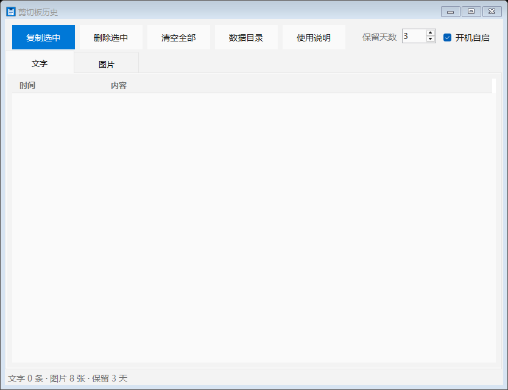

# ClipHistory · 剪切板历史

> 一个轻量的 Windows 剪贴板历史工具：自动记录复制过的**文字**和**图片**，默认保留 3 天，常驻系统托盘。
>
> 单文件 · 免安装 · 无需 .NET 运行时（Win10/11 自带）· 数据全部保存在本地



---

## 特性

- **自动记录**：文字（最多 1000 条）+ 图片（最多 200 张，存为 PNG）
- **保留 3 天**：可调 1–365 天，过期自动清理（启动时 / 每 5 分钟 / 改设置时）
- **托盘常驻**：单击托盘图标打开，关窗即缩到托盘
- **开机自启**：`--tray` 静默启动，不显示窗口、不弹提示
- **全局热键**：`Ctrl + Alt + V` 随时唤出
- **文字操作**：双击复制、`Ctrl+C`、`Ctrl+A`、`Delete`、右键菜单、**拖拽框选多选**
- **图片操作**：双击**用系统看图程序打开原图**，右键复制
- **便携模式**：数据、设置、日志全在 exe 旁的 `data` 文件夹，整个目录可拷走
- **现代化界面**：Win11 圆角、深色模式跟随系统、淡蓝选中框、行间分隔线

---

## 快速开始

从 [Releases](../../releases) 下载 `ClipHistory.exe`，双击即可运行。

```
ClipHistory.exe           ← 单个文件，直接运行
data\                     ← 首次运行自动创建，存放历史与设置
```

| 操作 | 效果 |
|---|---|
| 双击 exe | 打开主界面 |
| 单击托盘图标 | 打开主界面 |
| `Ctrl + Alt + V` | 全局唤出窗口 |
| 关闭窗口 `X` | 缩到托盘（继续记录） |
| 最小化 `—` | 留在任务栏 |
| 托盘右键 | 打开 / 清空历史 / 退出 |

> **首次运行提示"Windows 已保护你的电脑"**：本项目未购买代码签名证书，属正常现象。
> 点「更多信息」→「仍要运行」即可，或参考 [FAQ](#faq)。

---

## 使用说明

完整文档见 [docs/使用说明.md](docs/使用说明.md)（程序内点「使用说明」也能看）。

### 文字页

| 操作 | 效果 |
|---|---|
| 单击 | 选中（淡蓝高亮） |
| 双击 | 复制该条到剪贴板 |
| `Ctrl + C` | 复制选中项 |
| `Ctrl + A` | 全选 |
| `Delete` | 删除选中（有确认框） |
| 右键 | 复制 / 删除 / 全选 |
| 按住左键拖动 | 框选多个（`Ctrl`/`Shift` 追加） |

### 图片页

| 操作 | 效果 |
|---|---|
| **双击** | **用系统看图程序打开原图** |
| `Ctrl + C` / 右键 | 复制图片 |
| 拖动 | 框选多个 |

### 保留期限

默认 3 天，工具栏可改 1–365 天。清理时机：程序启动、运行中每 5 分钟、修改天数时。

> ⚠️ **删除是永久删除，不进回收站。**

---

## 数据存放（便携模式）

```
ClipHistory\
├── ClipHistory.exe
└── data\
    ├── texts.dat        文字记录（Base64）
    ├── images.dat       图片索引
    ├── settings.ini     设置（保留天数）
    ├── img\             图片 PNG
    └── logs\
        ├── start.log    启动日志
        └── crash.log    崩溃日志
```

- **换电脑 / 换盘**：复制整个文件夹即可
- **备份**：复制 `data`
- **清空**：界面「清空全部」，或删 `data`

只有开机自启写注册表（`HKCU\...\Run`），其余全部本地文件。

若 exe 所在目录不可写（如 `Program Files`），自动降级到 `%LOCALAPPDATA%\DSHClip`。

---

## 从源码编译

### 环境要求

- Windows 10 / 11
- .NET Framework 4.x（系统自带，**无需安装 Visual Studio**）

### 编译

```powershell
powershell -ExecutionPolicy Bypass -File .\build.ps1
```

产物：

```
dist\ClipHistory.exe     约 58 KB
```

脚本会顺便打印文件大小与 SHA256。

### 项目结构

```
ClipHistory-GitHub\
├── src\
│   ├── ClipHistory.cs      全部源码（单文件，约 2000 行）
│   ├── app.ico             程序图标（编译时嵌入）
│   └── app.manifest        应用程序清单（DPI / Win10 兼容）
├── docs\
│   ├── 使用说明.md          完整文档（编译时嵌入 exe）
│   └── screenshot.png      界面截图
├── .github\workflows\
│   └── build.yml           CI：自动编译 + 发版
├── build.ps1               编译脚本
├── README.md
└── LICENSE
```

---

## 技术实现

| 模块 | 做法 |
|---|---|
| 剪贴板监听 | `AddClipboardFormatListener` + `WM_CLIPBOARDUPDATE`（事件驱动，零轮询） |
| 文字存储 | `texts.dat`，每行 `Base64(时间戳) \t Base64(文本)` |
| 图片存储 | `img\*.png` + `images.dat` 索引（时间 / 文件名 / 宽高） |
| 列表渲染 | 自绘 `ListView`（`LVS_EX_DOUBLEBUFFER` 防闪烁） |
| 托盘 | `NotifyIcon`，单击唤出，右键菜单 |
| 单实例 | `Mutex` + 命名 `EventWaitHandle`（第二次启动唤出已有窗口） |
| 托盘静默 | 重写 `SetVisibleCore`，非用户操作时强制隐藏 |
| 窗口圆角 | `DwmSetWindowAttribute(DWMWA_WINDOW_CORNER_PREFERENCE)` |
| 深色模式 | 读注册表 `AppsUseLightTheme` 自动切换配色 |

---

## FAQ

**Q：为什么 Windows 提示"无法验证发布者"？**

本项目未购买代码签名证书（OV 证书约 ¥800/年）。未签名的 exe 会被 SmartScreen 拦截：
点「更多信息」→「仍要运行」。若文件带"来自网络"标记，可右键属性 → 勾选「解除锁定」。

**Q：双击图片不能预览？**

双击图片会用**系统默认看图程序**打开原图。若失败，状态栏会显示原因。

**Q：删除的记录能恢复吗？**

不能。删除是 `File.Delete`，不进回收站。

**Q：能记录复制的文件吗？**

暂不支持，只记录文字和图片。

**Q：怎么彻底卸载？**

删除文件夹 + 删除注册表 `HKCU\Software\Microsoft\Windows\CurrentVersion\Run\DSHClip`（若开过自启）。

---

## 贡献

欢迎提 Issue 和 PR。提交前请先跑一次：

```powershell
powershell -ExecutionPolicy Bypass -File .\build.ps1
```

确保编译无警告、无错误。

---

## 许可证

[MIT](LICENSE)

---

## English

**ClipHistory** is a lightweight clipboard history manager for Windows: it records copied **text** and **images**, keeps them for 3 days (configurable), and lives in the system tray.

- Single 58 KB executable, no installer, no runtime install needed (uses the built-in .NET Framework 4.x)
- Portable: all data lives in a `data` folder next to the exe
- Text & image tabs, double-click to copy / open, `Ctrl+C`, right-click menu, drag-select
- Global hotkey `Ctrl+Alt+V`, optional silent autostart (`--tray`)
- Build from source: `powershell -ExecutionPolicy Bypass -File .\build.ps1`

MIT licensed. Download the latest binary from [Releases](../../releases).
